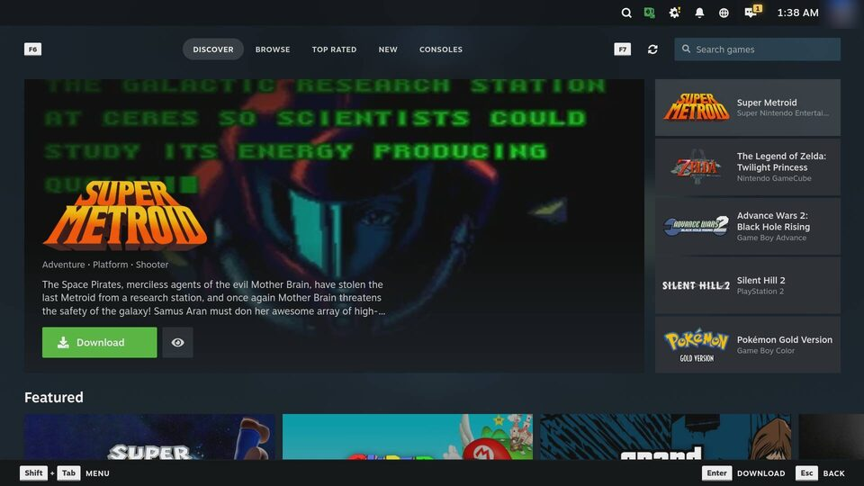
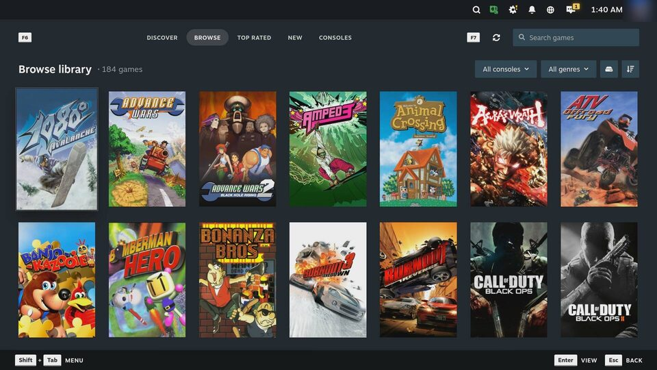
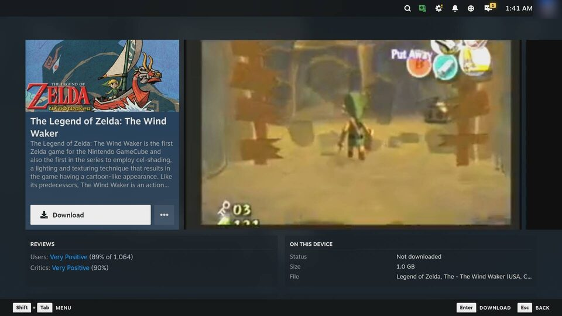
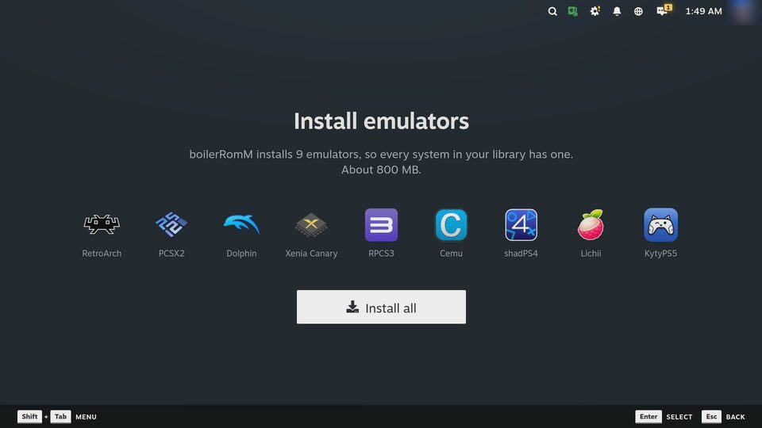
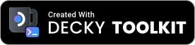

<h1 align="center">boilerRomM</h1>

<p align="center">
  <b>Your RomM library as a store in Steam Game Mode. Browse, download and play, with the emulators set up for you.</b>
</p>

<p align="center">
  <a href="LICENSE"></a>
  <a href="https://github.com/jackhric/boilerRomM/actions/workflows/ci.yml?query=branch%3Amain"></a>
  
  <a href="https://romm.app"></a>
</p>

<p align="center">
  <a href="#features">Features</a> ·
  <a href="#getting-started">Getting started</a> ·
  <a href="#development">Development</a> ·
  <a href="docs/architecture.md">Architecture</a>
</p>

<p align="center">
  
  
</p>

## Features

- Browse your [RomM](https://romm.app) library like a store: Discover, Browse, Top rated, New, Consoles and search
- Download a game and it is a normal Steam library entry, with progress on Steam's Downloads page
- Installs and sets up nine emulators: RetroArch, PCSX2, Dolphin, Xenia, RPCS3, Cemu, shadPS4, Lichii and KytyPS5
- Installs BIOS and firmware from your RomM server
- Pairs with a QR code, so no password is typed on the device

It ships no games, BIOS files or keys. RomM stays the catalogue.

<p align="center">
  
  
</p>

## Getting started

There is no release yet. You build it and deploy it.

### Requirements

- A Steam device in Game Mode with [Decky Loader](https://github.com/SteamDeckHomebrew/decky-loader).
- A [RomM](https://romm.app) server, version 5.4 or newer.
- [Decky Toolkit](https://github.com/jackhric/decky-toolkit), pnpm and [uv](https://docs.astral.sh/uv/).

### 1. Build and deploy

```sh
pnpm install
uv pip install --target py_modules --no-deps yt-dlp
pnpm build
npx decky-toolkit dev
```

`decky-toolkit dev` sends the plugin to a paired device. See the
[Decky Toolkit README](https://github.com/jackhric/decky-toolkit#getting-started) to pair one.

### 2. Set up

Open Quick Access and choose **boilerRomM**. A full-screen setup opens the first time:

1. Enter your RomM address.
2. Pair: scan the QR code with your phone, sign in to RomM and approve. Or open `<your RomM>/pair/device` in a browser and enter the short code.
3. Sign in to SteamGridDB for artwork.
4. Install the emulators. Firmware found on your server is installed too.

Then open the store, pick a game and press **Download**.

Settings has pages for Emulators, Server, BIOS Files, Storage and About.

## Development

```sh
pnpm install
uv pip install --target py_modules --no-deps yt-dlp
pnpm typecheck && pnpm test && pnpm build
uv run ruff check py_modules/boilerromm main.py tests && uv run ty check && uv run pytest
```

See [docs/architecture.md](docs/architecture.md) for how it fits together, [src/steam/README.md](src/steam/README.md)
for every hook into Steam, and [docs/romm-api.md](docs/romm-api.md) for the RomM endpoints used.

## License

[AGPL-3.0](LICENSE). It started from the [Decky plugin template](https://github.com/SteamDeckHomebrew/decky-plugin-template)
(BSD 3-Clause, notice in [LICENSES/BSD-3-Clause.txt](LICENSES/BSD-3-Clause.txt)).

<p align="center">
  <a href="https://github.com/jackhric/decky-toolkit"></a>
</p>
